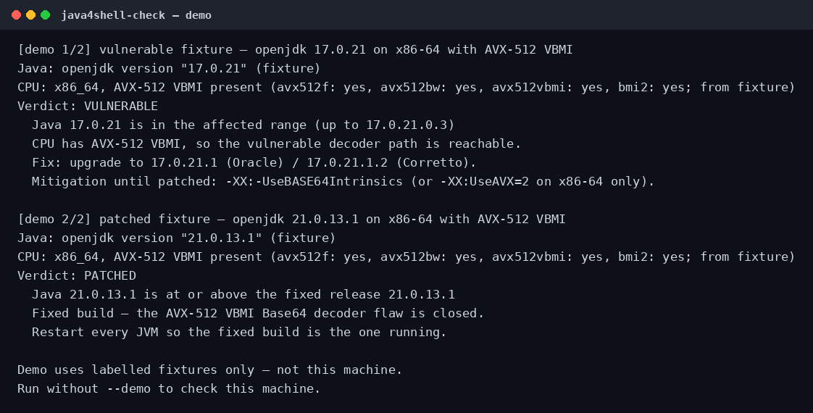

# java4shell-check



**Answer "am I exposed to Java4Shell?" in 0.06 seconds — one command, zero network calls, zero dependencies.**

A stdlib-only Python CLI that checks the two things that decide whether a host is exposed to Java4Shell (CVE-2026-114938): the Java version, and whether the CPU has AVX-512 VBMI. The real check takes a median **0.057 s** (7 runs, measured 2026-11-18 on this machine) — faster than opening the advisory page. No payloads, no network scanning, no exploit code: a defensive checker only.

## Why now

On **2026-11-17**, security firm **Calif** disclosed **CVE-2026-114938 ("Java4Shell")** — a memory-corruption flaw in OpenJDK's AVX-512 VBMI Base64 decoder. A malformed Base64 string ending with an extra `=` makes the decoder write past its output buffer. Calif rates it **9.2 (Critical) under CVSS 4.0**; Oracle, which assigned the CVE, rates it **8.1 (High) under CVSS 3.1**. Fixed builds shipped the same day.

What was verified from the sources below:

- The flaw is in the hand-written x86-64 assembly path of the Base64 decoder, not in any application or library — so every Java app that decodes attacker-controlled Base64 is in scope.
- **Affected:** OpenJDK 17.0.6 and later on the 17 line up to 17.0.21.0.3; Java 21 ≤ 21.0.13.0.3; Java 25 ≤ 25.0.5.0.3; Java 27 ≤ 27.0.1.0.3; Oracle Java SE **8u511b33-perf only** (standard Java 8 and Java 11 are **not** affected); GraalVM for JDK 17.0.21.0.3 / 21.0.13.0.3, GraalVM EE 21.3.20.0.3.
- **Fixed:** Oracle 17.0.21.1, 21.0.13.1, 25.0.5.1, 27.0.1.1 (released 2026-11-17); Corretto 17.0.21.1.2, 21.0.13.1.2, 25.0.5.1.2, 27.0.1.1.4. (The Java 8 Performance Pack fix is 8u513-perf.)
- **Hardware gate:** only x86-64 CPUs with AVX-512 VBMI — Intel Xeon Ice Lake / Sapphire Rapids / Emerald Rapids / Granite Rapids, AMD Zen 4+. ARM64 is not affected. On Linux, Calif notes all four of `avx512f`, `avx512bw`, `avx512vbmi` and `bmi2` must appear in `/proc/cpuinfo`; this tool gates on `avx512vbmi` and reports all four.
- **Pre-auth RCE demonstrated** (default configs): Keycloak, Atlassian Jira, Confluence, JFrog Artifactory, Jenkins, PingFederate. **Auth-required:** Kafka Broker, Solr, Elasticsearch, Gerrit, Spinnaker.
- **No exploitation in the wild reported as of 2026-11-17** — but Calif says there is no universal exploit only because each app needs its own chain, and that the chains were built largely with AI assistance. Patch now, don't wait for in-the-wild reports.
- Calif also describes a heap-read variant ("JavaBleed") that can leak heap contents — PII, private keys, tokens — without code execution.

Sources: [Censys advisory](https://censys.com/advisory/cve-2026-114938/) · [Wiz write-up](https://www.wiz.io/blog/cve-2026-114938-rce-java4shell-openjdk) · [CyberKendra](https://www.cyberkendra.com/2026/11/cve-2026-114938-pre-auth-rce-flaw-in-java-17-puts-servers-at-risk.html) · [suriq.io](https://suriq.io/blog/java4shell-cve-2026-114938-openjdk-base64-rce) · [DailyTechNow](https://dailytechnow.com/java4shell-openjdk-oracle-patch/) · [Vinish.Dev](https://vinish.dev/java4shell-openjdk-base64-flaw-cve-2026-114938)

## Quick start (30 seconds)

```bash
git clone https://github.com/Mahgal/java4shell-check.git
cd java4shell-check
python3 java4shell_check.py            # check this machine
```

No pip installs, no dependencies — Python 3 only. Try it without Java installed:

```bash
python3 java4shell_check.py --demo     # labelled fixtures: 1 vulnerable, 1 patched
python3 java4shell_check.py --java-path examples/fake-java-vulnerable.sh
python3 java4shell_check.py --java-path examples/fake-java-patched.sh
python3 java4shell_check.py --json     # machine-readable output for CI
```

Verified from a clean copy (fresh checkout in `/tmp`, 2026-11-18): `--demo` runs and the full test suite passes, 25/25, exit 0.

## Example output

Real output of `python3 java4shell_check.py --demo` (captured verbatim to `demo.txt`; re-runs reproduce it byte-for-byte, sha256 `1140bb9edb0c93961e73970c7818ecc4f70ef32d36992b8e2a713fe70b20b468`):

```
[demo 1/2] vulnerable fixture — openjdk 17.0.21 on x86-64 with AVX-512 VBMI
Java: openjdk version "17.0.21" (fixture)
CPU: x86_64, AVX-512 VBMI present (avx512f: yes, avx512bw: yes, avx512vbmi: yes, bmi2: yes; from fixture)
Verdict: VULNERABLE
  Java 17.0.21 is in the affected range (up to 17.0.21.0.3)
  CPU has AVX-512 VBMI, so the vulnerable decoder path is reachable.
  Fix: upgrade to 17.0.21.1 (Oracle) / 17.0.21.1.2 (Corretto).
  Mitigation until patched: -XX:-UseBASE64Intrinsics (or -XX:UseAVX=2 on x86-64 only).

[demo 2/2] patched fixture — openjdk 21.0.13.1 on x86-64 with AVX-512 VBMI
Java: openjdk version "21.0.13.1" (fixture)
CPU: x86_64, AVX-512 VBMI present (avx512f: yes, avx512bw: yes, avx512vbmi: yes, bmi2: yes; from fixture)
Verdict: PATCHED
  Java 21.0.13.1 is at or above the fixed release 21.0.13.1
  Fixed build — the AVX-512 VBMI Base64 decoder flaw is closed.
  Restart every JVM so the fixed build is the one running.

Demo uses labelled fixtures only — not this machine.
Run without --demo to check this machine.
```

The same two cases on the real machine, via the fixture java binaries in `examples/`:

```
$ python3 java4shell_check.py --java-path examples/fake-java-vulnerable.sh
Verdict: VULNERABLE        # exit 1
$ python3 java4shell_check.py --java-path examples/fake-java-patched.sh
Verdict: PATCHED           # exit 0
$ python3 java4shell_check.py --java-path examples/fake-java-vulnerable.sh \
    --cpuinfo examples/cpuinfo-without-vbmi.txt
Verdict: NOT_AFFECTED      # exit 0 — same Java, CPU without VBMI
```

Note: the real Linux cpuinfo flag is spelled `avx512vbmi` (no underscore) — `avx512_vbmi2` next to it does have one. The tool matches the exact token, so a host with only VBMI2 is correctly reported as not having VBMI.

## Verdicts

| Verdict | Meaning |
|---|---|
| `VULNERABLE` | Java is in an affected range **and** the CPU has AVX-512 VBMI. Upgrade now. |
| `PATCHED` | Java is at or above a fixed release. Restart every JVM so the fixed build is the one running. |
| `NOT_AFFECTED` | Either the Java line is not affected (standard Java 8, Java 11, or predates 17.0.6) or the CPU lacks AVX-512 VBMI. |
| `UNKNOWN` | No Java found, the version string could not be parsed, the Java line is not in the published table, or the CPU gate is unknown while the version is in an affected range. Upgrade to a known-fixed build to be certain. |

## Exit codes

| Code | Meaning |
|---|---|
| `0` | `PATCHED` or `NOT_AFFECTED` |
| `1` | `VULNERABLE` — by design, so it works as a CI gate |
| `2` | Usage error (bad flag, unreadable `--java-path` / `--cpuinfo` / `--apps` path) |
| `3` | `UNKNOWN` (this tool's own code — see Verdicts) |

## Affected / fixed version table

| Java line | Affected | Fixed in |
|---|---|---|
| 17 | 17.0.6 – 17.0.21.0.3 | 17.0.21.1 (Oracle) / 17.0.21.1.2 (Corretto) |
| 21 | ≤ 21.0.13.0.3 | 21.0.13.1 / 21.0.13.1.2 |
| 25 | ≤ 25.0.5.0.3 | 25.0.5.1 / 25.0.5.1.2 |
| 27 | ≤ 27.0.1.0.3 | 27.0.1.1 / 27.0.1.1.4 |
| 8 | **8u511b33-perf only** | 8u513-perf |
| 11 | not affected | — |

Versions that fall between the last known-affected and first known-fixed build (e.g. a hypothetical 17.0.21.0.4 — no public release sits there) are reported `UNKNOWN`, never guessed. Java lines outside the published table (e.g. 22) are likewise `UNKNOWN`.

## Also scan for exposed apps

```bash
python3 java4shell_check.py --apps /opt
```

Scans a directory tree (max depth 3) for install dirs of the apps Calif demonstrated RCE against — Keycloak, Jira, Confluence, Artifactory, Jenkins, PingFederate (pre-auth) and Kafka, Solr, Elasticsearch, Gerrit, Spinnaker (auth-required) — and reports which exposure class each one is in. Presence of an install dir does **not** prove it runs on an affected JVM; check the JVM that app actually uses. The `--apps` result never changes the exit code.

## Mitigation until patched

- Upgrade to a fixed build (table above) and restart every JVM.
- Or disable the vulnerable path: `-XX:-UseBASE64Intrinsics` (or `-XX:UseAVX=2`, x86-64 only — it fails to start on ARM). Calif recommends either, with no published data on effectiveness or performance cost.
- Where an instance was reachable while unpatched, review it for signs of use and rotate its credentials if compromise cannot be ruled out.

## Tests

Stdlib `unittest` only — no pytest, no network:

```bash
python3 tests/run_tests.py
```

25 tests, all passing (exit 0), covering: every version-table boundary row (17.0.5 safe, 17.0.6 vulnerable, 17.0.21.0.3 vulnerable, 17.0.21.1 fixed, 21.0.13.0.3 vulnerable, 21.0.13.1 fixed, 25.0.5.0.3 vulnerable, 25.0.5.1 fixed, 27.0.1.0.3 vulnerable, 27.0.1.1 fixed, 11.0.33 safe, 1.8.0_511 safe, 8u511b33-perf vulnerable, plus the 17.0.21.0.4 gap and an untabled Java 22 as `UNKNOWN`), malformed version strings, missing Java, CPU flag parsing (VBMI present/absent, `avx512_vbmi2` alone not counting as VBMI), demo determinism (two runs byte-identical), `--apps` detection, and CLI end-to-end runs with the fixture java binaries.

## Scope and honesty

- Defensive checker only. This repo contains **no exploit code, no payloads, and no network scanning** — it reads `java -version` output and `/proc/cpuinfo` and nothing else.
- It checks the version and CPU gates. It cannot prove an app is safe: any Java app that decodes attacker-controlled Base64 on an affected JVM/CPU is in scope, including apps Calif has not tested.
- On non-Linux systems there is no `/proc/cpuinfo`, so the CPU gate is honestly reported `UNKNOWN` instead of guessed.
- The `--demo` output uses labelled fixtures, not this machine, and says so in its own output.
